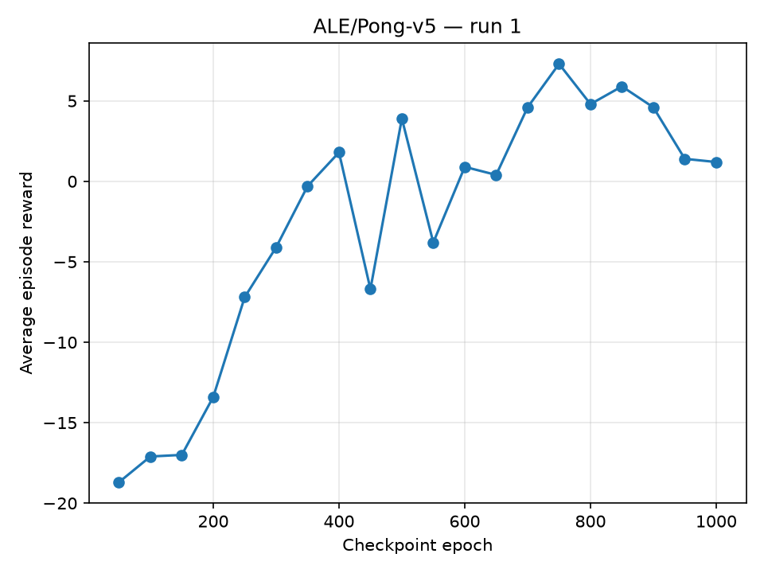

# DIAMOND — Diffusion for World Modeling: Visual Details Matter in Atari

This project is a PyTorch implementation of [DIAMOND](https://arxiv.org/abs/2405.12399) introduced by Eloi Alonso, Adam Jelley, Vincent Micheli, Anssi Kanervisto, Amos Storkey, Tim Pearce, and François Fleuret in *Diffusion for World Modeling: Visual Details Matter in Atari*.

DIAMOND learns a given environment's dynamics directly from images using a diffusion world model and trains an actor–critic model inside the learned world model. Its diffusion world model autoregressively predicts the next observation by denoising an image conditioned on past observations and actions. The diffusion world model is combined with a separate reward model that predicts rewards and episode termination, allowing the agent to learn from imagined trajectories.

The diffusion model uses [EDM preconditioning](https://arxiv.org/abs/2206.00364) and a U-Net conditioned on four previous frames and actions. Training alternates between collecting experience, fitting the world model and training the actor–critic in imagination.

## Training

### Setup

This implementation uses Python 3.11, PyTorch 2.8, and uv. Install the dependencies with:

```bash
uv sync
```

Checkpoints are saved locally and automatically uploaded to Hugging Face. Authenticate to Hugging Face using:

```bash
hf auth login
```

In the commands below, replace `YOUR_HF_USERNAME/diamond` with a Hugging Face model repository of your choosing.
This implementation uses Atari environments from the [Arcade Learning Environment](https://ale.farama.org/environments/pong/) through Gymnasium. The example below trains on Pong.

### Pong

```bash
uv run python main.py \
  --env_id ALE/Pong-v5 \
  --task_name pong \
  --action_space_dim 6 \
  --run_id 1 \
  --n_epochs 901 \
  --hf_repo_id YOUR_HF_USERNAME/diamond
```

The action dimension must match the environment: `ALE/Pong-v5` uses six discrete actions.

### Configuration and logging

| Option | Default | Meaning |
| --- | --- | --- |
| `--n_epochs` | `901` | Number of epochs |
| `--env_steps` | `100` | Number of actions collected per epoch |
| `--train_steps` | `400` | Number of updates per model per epoch |
| `--batch_size` | `32` | Batch size |
| `--L` | `4` | Number of past frames and actions conditioning the diffusion model |
| `--burn_in_len` | `4` | Number of observations used for burn in |
| `--im_horizon` | `15` | Imagination horizon |
| `--n_frame_skip` | `4` | Number of frmaes to skip when performing an action |
| `--n_sampling_steps` | `3` | Number of denoising steps when sampling |
| `--max_noop` | `30` | Maximum number of random initial no-op actions |
| `--gamma` | `0.985` | Discount factor |
| `--lbda` | `0.95` | λ coefficient |
| `--entropy_weight` | `0.001` | entropy regularization weight |
| `--lr` | `1e-4` | Learning rate |
| `--save_interval` | `50` | Checkpointing interval |
| `--log_every` | `10` | logging interval |

Logs are written to `logs/train_<run_id>.log`. To also track metrics in Weights & Biases, use the wandb option `--setup_wandb` when running main.py.

Checkpoints are saved under `checkpoints/run_<run_id>/checkpoint_epoch_<epoch>/`. The `models.pt` file contains the models, optimizer states, training metrics and the current epoch. The `dataset.pt` file contains current dataset. 

For example, to resume Pong training from a local checkpoint at epoch 500:

```bash
uv run python main.py \
  --env_id ALE/Pong-v5 \
  --task_name pong \
  --action_space_dim 6 \
  --run_id 1 \
  --resume \
  --epoch_to_load 500 \
  --n_epochs 901 \
  --hf_repo_id YOUR_HF_USERNAME/diamond
```

## Results

These results showcase a model trained on the Pong environment, with The reward plot displaying the mean total reward over 10 episodes for a given checkpoint, and the video showing the trained actor-critic playing the game in the environment. The agent controls the right paddle and tries to return the ball past its opponent while defending its own goal.

<table width="100%">
  <tr>
    <th width="50%">Evaluation reward</th>
    <th width="50%">Pong trajectory</th>
  </tr>
  <tr>
    <td align="center" valign="middle">
      
    </td>
    <td align="center" valign="middle">
      <video src="https://github.com/user-attachments/assets/fce103af-8615-4fdc-9274-7dc480df2072" controls muted loop playsinline preload="metadata" width="320" aria-label="Pong trajectory from run 1 at epoch 750"></video>
      <br>
      <a href="https://github.com/user-attachments/assets/fce103af-8615-4fdc-9274-7dc480df2072">Open video</a>
    </td>
  </tr>
</table>

### World model predictions

The following video compares real observations on the left with frames generated by the diffusion world model on the right. Starting from four real frames, the model predicts the rest of the trajectory autoregressively using a sequence of recorded actions, feeding each generated frame back into its history.

<video src="https://github.com/user-attachments/assets/65f661a5-5895-4aad-b99e-305ca2233d10" controls muted loop playsinline preload="metadata" width="960" aria-label="Real Pong observations compared with autoregressive world model predictions"></video>

[Open comparison video](https://github.com/user-attachments/assets/65f661a5-5895-4aad-b99e-305ca2233d10)

We can see that the world model is initially able to properly predict the observations, with the point counter even being consistent with what happens in the game (at least for the first goal), but gradually diverges over the course of the trajectory until the predicted observations and the world dynamics (such as the movement of the paddles and the ball) become nonsensical.

This behavior is explained by the fact that the diffusion world model only uses the past 4 frames and actions to condition its output and feeds that output back into that frame buffer as it autoregressively generates the next frames. Since the generated frames are not perfect, the prediction errors accumulate over the course of the trajectory, which ultimately leads to nonsensical predictions. The agent is still able to learn because the training starts from real observations and the training horizon is short enough that the world model is still good enough during that time. Furthermore, the agent leverages a trained reward model and doesn't depend on the in-game scoreboard being properly rendered.
